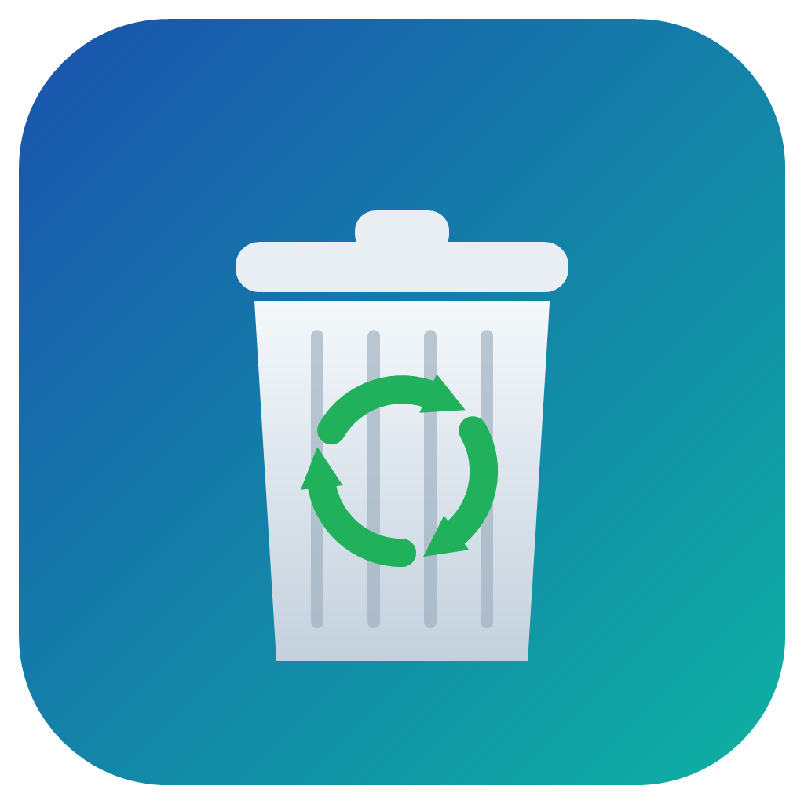

# EmptyRecycleBin（清空回收站）

打开即清空回收站的极简 Windows 工具，完成后弹出 Windows 通知并报告清理量。无窗口、无控制台、无第三方依赖，纯 C + Win32 Shell API（约 130 行），MinGW 两条命令即可编译。

A tiny Windows utility that empties the Recycle Bin on launch and reports how much was freed via a Windows toast notification. Pure C, Win32 Shell API, builds with MinGW in two commands.

## ⚠️ 注意

**运行即清空所有驱动器的回收站，不可恢复。** 请确认回收站内容确实不再需要后再运行。

## 功能

- 双击运行 → 静默清空回收站（无确认框、无进度条、无声音）
- 完成通知（右下角 toast，同时进入通知中心）：`回收站已清空，共清理 123.4 MB 垃圾。`
- 回收站本来就是空的：通知 `回收站本来就是空的。`
- 清空失败：错误通知，附 HRESULT 错误码
- 应用图标同时用于 exe 与通知（`NIIF_USER` 自定义通知图标）
- 退出码：`0` 成功，`1` 失败

## 构建

依赖 MinGW-w64（`gcc` + `windres`）：

```
windres --codepage=65001 app.rc -O coff -o app_res.o
gcc -O2 -s -mwindows empty_recycle_bin.c app_res.o -o EmptyRecycleBin.exe -lshell32 -lole32
```

`-mwindows` 表示 GUI 子系统（无控制台窗口）。

重新生成图标（可选，需 PowerShell）：

```
powershell -NoProfile -ExecutionPolicy Bypass -File make_icon.ps1
```

## 实现原理

1. `SHQueryRecycleBinW` 预先查询（判空 + 记录清理前总大小）
2. `SHEmptyRecycleBinW(NULL, NULL, SHERB_NOCONFIRMATION | SHERB_NOPROGRESSUI | SHERB_NOSOUND)` 清空所有驱动器
3. `Shell_NotifyIconW` + `NIF_INFO` 发出托盘通知（Windows 10/11 渲染为标准 toast 并进入通知中心）
4. 通知大图标用 `NIIF_USER | NIIF_LARGE_ICON` + `hBalloonIcon` 指定自定义图标；进程驻留约 6 秒，确保通知完整弹出后再移除临时托盘图标

## 踩过的坑

- **空回收站返回 E_UNEXPECTED**：`SHEmptyRecycleBin` 在回收站为空时返回 `0x8000FFFF` 而非 `S_OK` / `S_FALSE`，会被误判为失败。方案：先 `SHQueryRecycleBinW` 判空。
- **通知图标有首次快照缓存**：Windows 会在应用第一次发通知时把托盘图标截存为 PNG（`HKCU\Software\Classes\AppUserModelId\NotifyIconGeneratedAumid_*` 的 `IconUri`），之后一直显示旧图标。更换图标后需删除该注册表键与对应临时 PNG 让系统重建。
- **`NOTIFYICONDATA.hBalloonIcon` 受 `_WIN32_WINNT` 控制**：MinGW 默认目标版本较低时该成员和 `NIIF_LARGE_ICON` 不存在，需在 `#include <windows.h>` 前定义 `_WIN32_WINNT 0x0601`。
- **通知署名**：exe 需带版本资源（`FileDescription`），通知来源才显示应用名而不是文件名。

## 兼容性

Windows 10 / 11（在 Windows 11 24H2 实测）。构建环境：MinGW-w64 gcc 8.1.0。

## License

[MIT](LICENSE)
